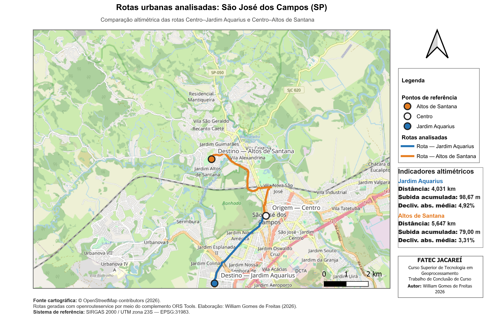

# GeoPilot TCC — comparação altimétrica QGIS × Python
[](https://colab.research.google.com/github/willigfreitas/geopilot-tcc-altimetria/blob/main/notebooks/geopilot_altimetria_colab.ipynb)

Repositório acadêmico do Trabalho de Conclusão de Curso de **William Gomes de Freitas**, desenvolvido na FATEC Jacareí.

O estudo compara indicadores altimétricos obtidos por dois fluxos aplicados às mesmas rotas urbanas de São José dos Campos (SP):

- procedimento manual padronizado no QGIS;
- processamento automatizado em Python.

O objetivo é verificar a equivalência entre os procedimentos, e não determinar a acurácia absoluta do MDE. Essa segunda avaliação exigiria dados independentes de campo.

## Área de estudo e rotas analisadas



*Figura 1 — Rotas Centro–Jardim Aquarius e Centro–Altos de Santana, em São José dos Campos (SP). Elaboração: William Gomes de Freitas (2026).*

## Escopo

O repositório trata exclusivamente de:

- amostragem de pontos ao longo de rotas;
- inclusão do ponto terminal exato;
- extração de cotas de um Modelo Digital de Elevação;
- média móvel centrada com janela de três amostras; nos pontos internos, são utilizadas três cotas e, nas extremidades da rota, os dois valores disponíveis;
- declividade por segmento;
- subida e descida acumuladas;
- comparação dos resultados do QGIS e do Python.

Não fazem parte do escopo acadêmico cálculos de combustível, massa veicular, energia, custos operacionais ou rentabilidade.

## Rotas analisadas

| Rota | Distância | Amostras | Cota inicial | Cota final | Subida | Descida | Declividade absoluta média |
|---|---:|---:|---:|---:|---:|---:|---:|
| [Centro–Jardim Aquarius](resultados/jardim_aquarius/) | 4,031 km | 136 | 605,50 m | 604,00 m | 98,67 m | 100,17 m | 4,92% |
| [Centro–Altos de Santana](resultados/altos_santana/) | 5,647 km | 190 | 606,50 m | 580,50 m | 79,00 m | 105,00 m | 3,31% |

Na comparação padronizada, as cotas e os indicadores derivados coincidiram entre os dois fluxos, com MAE, RMSE e diferença máxima iguais a 0,00 m.

Os arquivos produzidos para cada rota — perfil altimétrico em CSV, pontos amostrados em GeoPackage, resumo da rota e parâmetros da execução em JSON — estão disponíveis nas respectivas pastas de resultados.

## Estrutura

```text
.
├── .github/workflows/                 # integração contínua
├── tools/geopilot_geo_route.py        # automação altimétrica
├── tests/                              # testes automatizados
├── notebooks/
│   └── geopilot_altimetria_colab.ipynb
├── docs/
│   ├── metodologia.md                  # regras do experimento
│   ├── reproducao.md                   # execução em outra máquina
│   └── imagens/                        # mapa temático
├── dados/README.md                     # dados necessários e licenças
├── resultados/
│   ├── jardim_aquarius/                # resultados da primeira rota
│   └── altos_santana/                  # resultados da segunda rota
├── requirements.txt
└── CITATION.cff
```

## Execução no Google Colab

O notebook pode ser executado diretamente no navegador, sem instalação local do ambiente Python:

[**Abrir o notebook no Google Colab**](https://colab.research.google.com/github/willigfreitas/geopilot-tcc-altimetria/blob/main/notebooks/geopilot_altimetria_colab.ipynb)

Para uma nova execução, o usuário deve fornecer:

- uma rota em formato GeoPackage (`.gpkg`);
- um Modelo Digital de Elevação em formato GeoTIFF (`.tif`).

O notebook utiliza o script oficial deste repositório e gera os mesmos quatro arquivos documentados na seção de saídas.

## Uso local

```powershell
py -m venv .venv
.\.venv\Scripts\Activate.ps1
python -m pip install --upgrade pip
python -m pip install -r requirements.txt

python .\tools\geopilot_geo_route.py `
  --routes "C:\caminho\rota.gpkg" `
  --dem "C:\caminho\mde.tif" `
  --output "C:\caminho\resultado" `
  --crs "EPSG:31983" `
  --sample-spacing 30
```

Consulte [docs/reproducao.md](docs/reproducao.md) para o procedimento completo.

## Saídas

Cada execução produz:

- `perfil_altimetrico.csv`;
- `pontos_perfil.gpkg`;
- `resumo_rota.json`;
- `parametros_execucao.json`.

## Testes

```bash
python -m pytest -q
```

Os testes também são executados automaticamente pelo GitHub Actions.

## Dados

O MDE completo não é versionado neste repositório. As instruções para obtenção e preparação dos dados estão em [dados/README.md](dados/README.md). Para reproduzir uma execução, o usuário deve fornecer localmente a geometria da rota e o MDE correspondentes.

## Autoria

William Gomes de Freitas — Curso Superior de Tecnologia em Geoprocessamento, FATEC Jacareí, 2026.

## Estado do repositório

Versão acadêmica reprodutível. O código, os testes automatizados, o notebook para Google Colab e os resultados das duas rotas analisadas estão publicados. Os resultados documentam a equivalência entre os fluxos do QGIS e do Python para os dados e parâmetros utilizados neste estudo.
